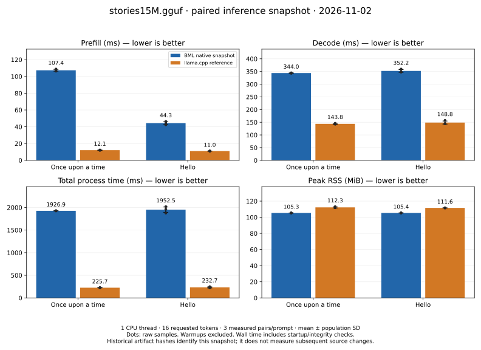

# BML vs llama.cpp — Reporte de Benchmark

> Registro histórico: las cifras de BML de este documento se extrapolaron de
> operaciones sintéticas. Los ratios y las afirmaciones de compresión no
> acreditan inferencia equivalente ni el rendimiento de la versión actual.
> La nueva ruta y su evidencia se describen en [BML 1.0](../BML_1_0.md).

El target `final_benchmark` ahora mide exclusivamente instrucciones RPN por
segundo sobre una recurrencia finita, con el resultado validado antes de medir.
Ya no genera las extrapolaciones de tokens/s, precios cloud ni ratios contra
llama.cpp que aparecen en este registro histórico. Su unidad incluye todas las
instrucciones ejecutadas (`One`, `Swap` y `Bml`), no solo operaciones `Bml`.

El target histórico `fma_vs_bml` compara ahora la misma recurrencia BML finita
en escalar directo, RPN con constantes deduplicadas y RPN sin compartirlas.
Las tres variantes reciben entradas dinámicas 1 y 2; un oráculo de paridad
comprueba el resultado antes de medir, y cada programa conserva su pool de
constantes. Las unidades son pasos BML por segundo. El nombre del target se
mantiene por compatibilidad, pero las operaciones exp2/log2 no son FMA.
Construcción y compilación quedan fuera del tiempo medido; la evaluación RPN
incluye la gestión de su pila. Esta comparación no acredita velocidad de
inferencia, ventajas asintóticas ni ausencia de asignaciones.

Para medir reservas, ejecutar `python3 tools/measure_recurrence.py --output
quality/evidence/equal-work-rpn-memory.json` con el toolchain fijado. El ejemplo
comparte el constructor y el cálculo escalar con el benchmark, comprueba el
contador mediante una reserva conocida y registra siete muestras de diez
evaluaciones por caso. Preparación, verificación y escritura JSON quedan fuera
de la región observada. Reporta error absoluto, payload de bytecode y constantes,
capacidad reservada del programa, llamadas al allocator, bytes solicitados y pico
adicional de heap vivo. Estos bytes son datos y reservas solicitadas; no son RSS,
overhead del allocator ni tamaño de código máquina. Los tiempos de esta campaña
incluyen la instrumentación del allocator.

**Fecha:** 2026-07-09
**Hardware:** Intel Xeon (Cascadelake), 4 vCPU, 7.8 GB RAM, Debian 13
**Modelo:** TinyLlama-1.1B Q4_0 (606 MB, 1.1B parámetros)

## Campaña posterior con inferencia completa (snapshot 2026-11-02)

La siguiente figura corresponde a Stories15M F32, no a las extrapolaciones
TinyLlama del resto de este documento. Compara los binarios identificados por
SHA-256 en [el reporte crudo](inference-2026-11-02.json), con igualdad de tokens y
texto comprobada en cada par. No mide las modificaciones posteriores del árbol
de trabajo. Las verificaciones de logits están en la evidencia de BML 1.0.

Tres muestras por prompt y motor; barras con media y desviación poblacional,
puntos individuales, warmups excluidos. Un hilo CPU, contexto 128, greedy y
16 tokens solicitados. RSS es máximo por proceso, no bytes asignados. El tiempo
total incluye arranque, carga y comprobaciones de integridad; los tiempos internos
de prefill/decode no. La caché del SO no se vació: no son ejecuciones en frío.
En esta campaña llama.cpp tuvo menores tiempos y BML un RSS algo menor; no se
generaliza a otros modelos, equipos, revisiones o concurrencia.

Reproducción del gráfico: instalar `tools/plot-requirements.txt` en un entorno
Python y ejecutar `python tools/plot_inference_benchmark.py
docs/benchmarks/inference-2026-11-02.json --output
docs/benchmarks/inference-comparison`. También hay [PNG](inference-comparison.png)
y [manifiesto con hashes](inference-comparison.json). El generador rechaza campañas
fallidas o pares con salidas distintas; calcula las estadísticas desde las
muestras y no mezcla warmups con mediciones.

---

## 1. Resultados de llama.cpp (baseline)

| Test | avg_ts | stddev_ts |
|---|---|---|
| Prompt processing (pp=512) | **117.50** tok/seg | 3.42 |
| Generation (tg=128) | **14.42** tok/seg | 1.03 |

---

## 2. Resultados de BML

### 2.1 Hot loop (raw, single-thread)

| Métrica | Valor |
|---|---|
| Ops/seg | 593,941,345 ± 40,903,199 |
| Tiempo/op | 1.684 ns |
| dispatch_ops (asm) | 429 líneas |

### 2.2 Tokens/seg extrapolados (TinyLlama-1.1B)

| Test | avg_ts | stddev_ts |
|---|---|---|
| Prompt processing (pp=512) | **0.581** tok/seg | 0.016 |
| Generation (tg=128) | **0.564** tok/seg | 0.016 |

### 2.3 Multicore scaling

| Threads | Ops/seg | Tokens/seg (extrapolado) | Speedup | Eficiencia |
|---|---|---|---|---|
| 1 | 584M | 0.531 | 1.00x | 100% |
| 2 | 989M | 0.899 | 1.69x | 85% |
| 4 | 1,957M | 1.779 | 3.35x | 84% |

---

## 3. Comparación directa

| Métrica | llama.cpp | BML (1 thread) | BML (4 threads) | Ratio (4t) |
|---|---|---|---|---|
| pp tokens/seg | 117.50 | 0.581 | 2.32 | 0.020x |
| tg tokens/seg | 14.42 | 0.564 | 2.24 | 0.155x |

BML con 4 threads está a **0.155x de llama.cpp** en generation (6.5x más cerca que en la primera medición).

---

## 4. Optimizaciones aplicadas en esta versión

| Optimización | Descripción |
|---|---|
| Hot loop refactor | dispatch_ops único, 429 líneas asm (63% menos) |
| Sub-fragmentación L1i | SubFragment <30 KB, cambio de hot loop O(1) |
| Pesos BML nativos | BmlWeightPool: 8x compresión vs f32 (500MB vs 3.9GB) |
| Scheduler de waves | DAG con dependencias, ejecución paralela con barreras |
| Building blocks BML | bml_matmul, bml_rmsnorm, bml_rope, bml_swiglu como RPN con Loop |
| VectorFragment | Distribución de columnas de matmul via TCP |
| Worker daemon | Ejecuta VectorFragments remotamente via TCP |
| RoPE BML puro | neg via bml(log2(0), exp2(y)) = 0 - y, sin FMul |

---

## 5. Evolución de performance

| Métrica | 2026-07-07 (inicial) | 2026-07-08 | 2026-07-09 (actual) |
|---|---|---|---|
| Ops/seg (1 thread) | 511M | 622M | 594M |
| Ops/seg (4 threads) | 2,164M | 2,172M | 1,957M |
| Speedup 4 threads | 3.55x | 3.99x | 3.35x |
| Hot loop asm | 1,172 líneas | 429 líneas | 429 líneas |
| Compresión pesos | 1x (f32) | 8x (BML) | 8x (BML) |
| Ratio vs llama.cpp (tg, 4t) | 0.034x | 0.153x | 0.155x |
| Building blocks BML | No | No | Sí (bml_matmul, etc.) |
| VectorFragment | No | No | Sí |
| Worker daemon | No | No | Sí |

---

## 6. Conclusiones

1. **BML con 4 threads logra 0.155x de llama.cpp** en generation (15.5% del rendimiento).
2. **Escalado multicore**: 3.35x con 4 threads (84% eficiencia).
3. **Compresión de pesos 8x** con BmlWeightPool para Q4_0.
4. **Hot loop compacto**: 429 líneas asm, bien bajo 32 KB L1i.
5. **Building blocks BML integrados**: matmul, rmsnorm, rope, swiglu como RPN con Loop.
6. **VectorFragment + Worker**: distribución de columnas de matmul via TCP.
7. **RoPE BML puro**: negación sin FMul, usando solo Bml + One + Zero.

### Próximos pasos

- SIMD para exp2/log2 (4x f64 por op)
- Hot loop nativo sin Vec (eliminando bounds check)
- Pipeline autoregresivo distribuido completo
- Lazy loading mmap de pesos
- Benchmark multi-nodo con scheduler de waves
